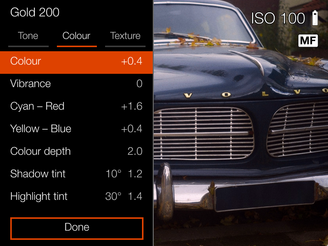
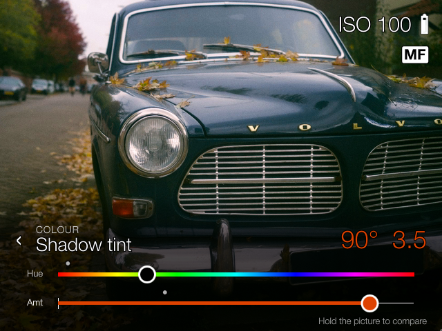
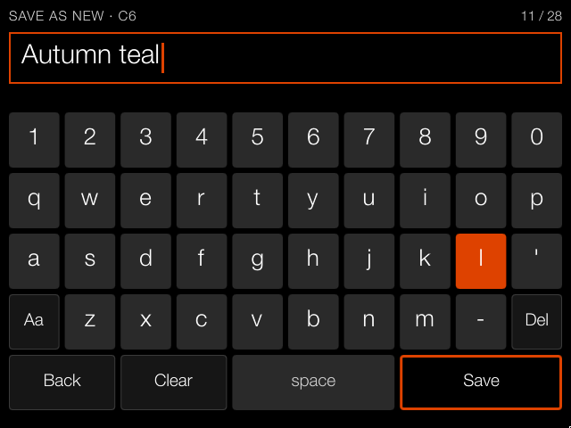

# Hazel for the X1D-50c

Film looks in the live view of a Hasselblad X1D-50c (the first model, firmware 1.25.0). What
you see in the viewfinder is the look the photo gets, and each photo gets a small `.look` file
next to it saying which recipe it was taken with. The raw files themselves are never changed.

Everything goes over the camera's USB cable, from [the Hazel app](https://hazel-one-weld.vercel.app) in Chrome or
Edge, or from a Terminal on a Mac. Nothing is opened, nothing is flashed, and no firmware is
replaced. Take the memory card out and the camera starts as it always did.

> Not made by, endorsed by or affiliated with Hasselblad. You run this on your own camera at your
> own risk. It was built and tested on one camera.
>
> Written with Claude (Anthropic's AI assistant) and checked on a real camera.

## What's here

- `catkin`, `camera/`, `usb/`: **Catkin**, the loader. Installed once, it runs a setup from the
  memory card every time the camera starts.
- `hazel/`: **the film look**, ready-built: the setup Catkin loads from the card, with seven
  recipes in its slots.
- `release/hazel.tar`: the same setup in one file, which the Hazel app installs.
- `docs/`: the pictures in this README.

The recipes themselves, and more of them, are in
[Hazel-film-recipes](https://github.com/duart38/Hazel-film-recipes).

## What it changes on the camera

| Where | What | Stays after a restart? |
| --- | --- | --- |
| system partition, `/etc/systemd/system/` | `x1d-card-loader.service`, and a link to it | yes, until a firmware update |
| data partition, `/media/data/x1d-card-loader/` | the loader script and its key | yes |
| data partition, `/media/data/x1d/` | the slot and look you picked last, and debug logs if you switch them on | yes |
| memory only (`/tmp`, `/run`) | the film look itself | no |

The service is the only change to the camera's own software, and a firmware update removes it.

## Install from the browser

The easy way, on a Mac, Windows or Linux computer with Chrome or Edge:

1. Put a memory card in the camera, switch it on, and connect it to the computer with its USB-C
   cable.
2. Open [the Hazel app](https://hazel-one-weld.vercel.app), go to **Camera**, press **Connect** and choose X1D-50c.
3. Press **Install Hazel**. The first time, it asks before the one lasting change, the start-up
   service in the table above.
4. Restart the camera. Within about half a minute of switching on, the look is on.

It takes about half a minute and gives the camera its key. The same page shows which Hazel the
camera runs, updates it when a newer one is here, and removes it again. It was tested on a Mac;
Windows may need a USB driver for the camera before Chrome can see it.

## Install from the Terminal

The same steps by hand, if you'd rather.

### You need

A Mac, the camera with firmware 1.25.0, its USB-C cable, Python 3 and libusb:

```bash
brew install libusb
```

```bash
python3 -m venv .venv && .venv/bin/pip install pyusb
```

### 1. Put the loader on the camera

Switch the camera on, connect it to the Mac, then:

```bash
.venv/bin/python catkin install
```

It shows exactly what it will change and asks you to type `install` before doing it. It also
gives the camera a key. The camera only runs a card setup sealed with its own key, so a stranger's
card can't run anything on it. The key stays on the camera: whenever the camera is connected,
Catkin seals with the camera's key and keeps a copy on your Mac (`~/.config/catkin/key`), so any
computer works, and a card sealed in a card reader uses the key of the camera last connected.

`.venv/bin/python catkin status` shows what's installed at any time.

### 2. Prepare the memory card

Seal the film look with your key:

```bash
.venv/bin/python catkin pack hazel
```

Then copy it onto the card, either with the card in a card reader:

```bash
.venv/bin/python catkin card --to /Volumes/CARD
```

or with the card in the camera:

```bash
.venv/bin/python catkin card --usb
```

This puts `CATKIN.TAR` and `CATKIN.SIG` at the top of the card. Restart the camera with the card
in. Within about half a minute of switching on, the look is on.

To check it first without restarting, run `.venv/bin/python catkin try`. It loads the card's
setup right away and prints what happened.

## Using it

On the camera: **Menu › General Settings › Hazel**. Switch the film look on or off, and pick one of the seven
recipe slots.

The recipe's name shows in live view and on the info screen; tap it to pick another slot there.
In playback, a photo shows the name of the recipe it was taken with, on the left above the bottom
bar. Tap it to see that photo with another recipe, or with the film look off. Only the photo's
`.look` file next to it on the card changes; the raw file stays exactly as it was shot, and you can
pick the first recipe again at any time.

To change a recipe on the camera, tap the sliders button next to its name in live view. Pick a
setting from the list, then turn either wheel while you watch the picture change; hold the
picture to see the saved recipe for comparison. When you're done, save it to its slot, save it as
a new slot (with a keyboard for its name), use it without saving, or discard the changes. Saved
recipes go to the card's `HAZEL/recipes` too.

| Pick a setting | Turn the wheels, watch the picture | Name a new recipe |
| --- | --- | --- |
|  |  |  |

These are the camera's own screens, with the film look applied to the live view.

To use other recipes, put text files named `C1.txt` to `C7.txt` in a `HAZEL/recipes` folder on
the card (at most 2 KB each). The camera reads them when it starts and when you open the menu.
There are recipes to start from in
[Hazel-film-recipes](https://github.com/duart38/Hazel-film-recipes). Without that folder, the
camera uses the seven recipes in `hazel/slots`.

Formatting the card in the camera removes the setup, like everything else on the card.

## Undo

- **Back to stock for one start:** take the card out, or delete `CATKIN.TAR` from it.
- **Remove the loader:** **Remove Hazel** on the Camera page of [the Hazel app](https://hazel-one-weld.vercel.app), or
  `.venv/bin/python catkin remove`. Either deletes the service and
  `/media/data/x1d-card-loader`. The few bytes of settings in `/media/data/x1d` stay; without the
  loader nothing reads them.
- A firmware update also removes the service.

## Credits

The USB tools in `usb/` come from
[YuHaoyua/hasselblad-x1d-reverse-engineering](https://github.com/YuHaoyua/hasselblad-x1d-reverse-engineering)
(MIT licence, see `usb/LICENSE`).
